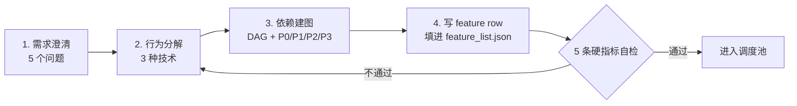
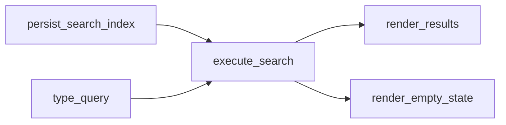
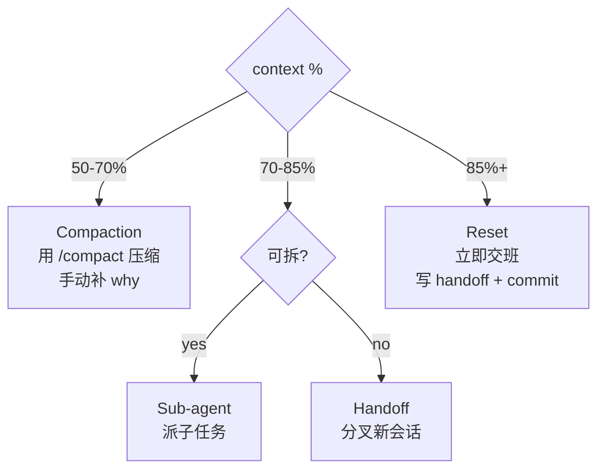

# Harness 部署手册 — Agent 给项目仓库装上 Harness 的完整 SOP

> **本文档定位**:不是教程,是**操作手册**。给一个 agent 一份文档,让它读完就能:
>
> 1. 知道项目仓库里**要创建哪些文件**
> 2. 知道**和用户讨论哪些问题**
> 3. 讨论完之后,一套**可跑任务的 harness 就成型了**
>
> **来源**:综合 6 篇 harness 子系统精讲 + 官方 Anthropic harness-engineering 仓库
> **适用**:任何准备用 AI agent 做长周期、多 feature 任务的代码仓库
> **不适用**:一次性脚本 / demo 项目

---

## 📌 本仓库的落地(已实装,agent 先看这里)

> 本手册是**通用方法论**。本仓库(`llm-learning`)已经按它装好了 harness,
> 下面这张表是**实际文件**——**别照着手册重新造,直接读这些**:

| 文件 | 状态 | 内容 |
| ---- | ---- | ---- |
| [`AGENTS.md`](AGENTS.md) | ✅ 已落地 | **本项目定制操作手册**:framing、10 条硬约束、三层验证路径、DoD、路由表 |
| [`CLAUDE.md`](CLAUDE.md) | ✅ 已落地 | Claude Code 入口版,规则本体在 AGENTS.md |
| [`init.sh`](init.sh) | ✅ 已落地 | 轻量 smoke(L0 环境 / L1 纯 Python 数据层 / L2 torch 前向 / L3 仓库卫生),< 1 分钟 |
| [`feature_list.json`](feature_list.json) | ✅ 已落地 | 10 条 feature 的状态机,WIP=1,每条带可执行 verification |
| [`claude-progress.md`](claude-progress.md) | ✅ 已落地 | session 日记 + 当前已验证状态 |
| [`session-handoff.md`](session-handoff.md) | ✅ 已落地 | 交接卡(已填 feat-001 环境阻塞情况) |
| [`clean-state-checklist.md`](clean-state-checklist.md) | ✅ 已落地 | 收班清单,6 项通用 + 3 项本项目特有 |
| [`README.md`](README.md) | ✅ 已落地 | 给人看的项目说明与笔记索引 |
| `docs/` 7 个政策文档 | ❌ 未建 | 本项目 feature 数 10 个、1 人维护,L1/L2 档位够用,**按需再加** |

**agent 每次开工的最短路径**:

```bash
cat AGENTS.md && cat feature_list.json && bash init.sh
```

**本项目与通用手册的 3 处偏差**(手册是通用 SOP,这里按学习仓库的实际改了):

1. **验证不做全量训练**。通用手册的 `init.sh` 跑 lint+test+build 全套;本项目是 CPU 上 10 分钟的
   RLHF 训练链,做不起每次开机就跑。因此拆成 L0-L3 四层,`init.sh` 只跑 L0/L1/L2/L3 的轻量部分,
   全量训练(L3)改为**动到训练/评估代码时才手动跑**,见 `AGENTS.md` §5。
2. **允许 SKIP,不允许静默通过**。本机 torch 目前加载不了,`init.sh` 的 L2 层输出 `[SKIP]` 而非 `[FAIL]`,
   不阻塞纯 Python 数据层的工作;但任何非 torch 检查失败一律 FAIL 并以非 0 退出码中断。
3. **DoD 多了一条笔记门槛**。通用手册的 DoD 是"实现 + 验证 + evidence + 可重启";
   本项目多一条:**笔记改动的 feature 必须抽样核对 ≥3 处与 `config.py` / 源码一致**——
   因为这是个学习仓库,笔记与代码不一致就是硬伤,见 `AGENTS.md` §6。

手册正文(第一~七部分 + 附录 A~E)作为**方法论参考**保留,不随本仓库状态改动。

---

## 📌 目录速览(给 agent 的"地图")


| #            | 章节                                   | 你(agent)要做什么                    | 耗时                   |
| ------------ | -------------------------------------- | ------------------------------------ | ---------------------- |
| **第一部分** | 哲学速读(为什么是 5 文件,不是 50 文件) | 读懂 5 子系统,知道最小骨架           | 5 min                  |
| **第二部分** | 仓库初始化 SOP                         | 在仓库里**创建 4-7 个核心文件**      | 30 min                 |
| **第三部分** | 跟用户的对话脚本                       | **逐题问用户**10 个关键问题          | 15-30 min              |
| **第四部分** | 任务拆解(从需求到 feature\_row)        | 用 4 阶段流程生成 feature\_list.json | 30-60 min              |
| **第五部分** | 跑任务 SOP(start/middle/end)           | 严格按 6/6/5 步走 session 周期       | 每个 session 30-90 min |
| **第六部分** | 上下文满应对(4 阈值 + 4 策略)          | 主动监控 context,4 阈值分别做什么    | 持续                   |
| **第七部分** | 常见反模式                             | 给 agent 自己看的预警清单            | 持续                   |
| **附录 A**   | 完整模板(可直接复制)                   | 7 个文件的 source code               | —                      |
| **附录 B**   | 给用户的 FAQ                           | 用户问"为啥要这样"时的回答           | —                      |

---

# 第一部分:哲学速读(5 分钟必读)

## 1.1 Harness 是什么?

> **Harness = 模型权重以外的一切。** 不是参数就是 harness。

Agent 没有 harness 就像一个**健忘的天才工匠**:

* 每次开工**重读整个仓库**(15 分钟)
* **随手改超出范围**的代码(scope creep)
* **看不到自己写的 bug**(Generation-Evaluation Asymmetry)
* **session 一断就失忆**(amnesiac craftsman)

harness 就是给这个工匠**装上的工作装备**:操作手册 + 进度本 + 检验台 + 任务边界 + 值班交接。

## 1.2 5 子系统(Kitchen 比喻)


| 子系统                | 工匠比喻 | 提供什么                                               | 防什么                      |
| --------------------- | -------- | ------------------------------------------------------ | --------------------------- |
| **Instructions**      | 操作手册 | `AGENTS.md`+ 政策文档                                  | 瞎选技术栈、瞎定命名        |
| **State**             | 进度本   | `feature_list.json`+`progress.md`+`session-handoff.md` | session 间断层、重复劳动    |
| **Verification**      | 检验台   | `init.sh`+ e2e + 三层终止检查                          | 假完成、自评过宽            |
| **Scope**             | 任务边界 | WIP=1 + Definition of Done                             | Overreach、Under-finish     |
| **Session Lifecycle** | 值班交接 | 启动 6 步 + 收班 5 步 + clean state 5 维               | 半成品代码、跨 session 失忆 |

**这 5 个一个都不能省**。省哪一个,就掉哪一类失败。

## 1.3 最小骨架:4 件套

> **"Those four files are enough to make most agent workflows noticeably more stable."** — 官方原话

```
AGENTS.md (or CLAUDE.md)   → Instructions 子系统
init.sh                    → Verification 子系统入口
feature_list.json          → State 子系统骨干
claude-progress.md         → State 子系统日记
```

**项目长大后**,再加:

* `session-handoff.md` — 长 session 交接
* `clean-state-checklist.md` — session 末检查
* `docs/SECURITY.md` / `docs/ARCHITECTURE.md` / `docs/PLANS.md` 等 7 个政策文件

## 1.4 一个核心铁律

> **Anything not in the repo doesn't exist for the agent.**

Slack 里的讨论、Confluence 里的 wiki、人脑子里的"潜规则"——**对 agent 全都不存在**。harness 第一原则:**所有 agent 需要的知识,必须写到仓库里**。

---

# 第二部分:仓库初始化 SOP(agent 自己做)

## 2.1 准备阶段:检查仓库

**在动手前,先检查仓库现状**。这避免在已有 harness 的项目上重复造轮子。

```bash
# 1. 确认你在项目根目录
pwd

# 2. 检查是否已有 harness 痕迹
ls -la | grep -E "(AGENTS\.md|CLAUDE\.md|init\.sh|feature_list|claude-progress|session-handoff|clean-state)"
ls -la .claude/ 2>/dev/null

# 3. 检查 .claude/ 目录(已有 skill、settings 等)
ls -la docs/ 2>/dev/null

# 4. 检查 git 状态(必须是干净或可恢复)
git status
```

**判断分支**:

* **已有 harness** → 读 AGENTS.md,按它的规则跑;不要覆盖
* **空仓库 / 完全没有 harness 文件** → 进入下面的初始化
* **有部分文件(比如只有 README)** → 增量补齐

## 2.2 创建 7 个核心文件

按这个**顺序**创建(后面的文件会引用前面的):

```
仓库根/
├── AGENTS.md               ← 1. 操作手册(routing 文件,~100 行)
├── CLAUDE.md               ← 2. 给 Claude 的等价版本(可与 AGENTS.md 同源)
├── init.sh                 ← 3. 启动 + 验证脚本
├── feature_list.json       ← 4. 任务状态机(backbone)
├── claude-progress.md      ← 5. session 日记
├── session-handoff.md      ← 6. 长 session 交接卡(可空,首次 session 末填)
├── clean-state-checklist.md ← 7. session 末检查清单
└── docs/                   ← 8. 政策文档(可选,见 §2.3)
    ├── ARCHITECTURE.md
    ├── SECURITY.md
    └── ...
```

**所有模板在附录 A,直接复制粘贴**。

## 2.3 创建顺序与原则

### 第 1 步:写 `AGENTS.md`(操作手册)

**原则**:**只放最常用的 + 高优先级硬约束**,≤ 200 行。

**模板**:见附录 A.1

**写入决策**:

* 首段 **2-3 句**:项目是什么 + agent 应优化什么(用 MUST/Prefer 措辞)
* **必须 6 段式**:Project Framing / Startup Workflow / Working Rules / Required Artifacts / Definition of Done / End of Session
* Hard Constraints ≤ 15 条,放**顶部或底部**(防 Lost in the Middle)
* 加 **Identity 埋点**(agent 名字)便于启动检测 — 这是防"agent 没读"的最小成本方案

### 第 2 步:写 `CLAUDE.md`(给 Claude 用的同义版本)

如果你的 agent 是 Claude Code,**AGENTS.md 和 CLAUDE.md 二选一即可**(Claude Code 优先读 CLAUDE.md)。两份内容可以一致,但**保留两份方便后续给不同 agent 用**。

### 第 3 步:写 `init.sh`(启动 + 验证脚本)

**原则**:**任何 session 开始都先跑它**,确认 baseline 健康。

**模板**:见附录 A.3

**关键纪律**:

* 用 `set -e`,任何命令失败立即退出
* 必须包含:**依赖安装 + lint/typecheck + tests + build**(e2e 可选,跑太慢)
* 末尾输出"next steps"提示,引导 agent 读 progress + feature\_list

### 第 4 步:写 `feature_list.json`(任务状态机)

**原则**:**机器可读的 source of truth**,每个 feature 一条 row,3 字段缺一不可(behavior + verification + status)。

**模板**:见附录 A.4

**关键纪律**:

* 顶部 `rules` 块固定 WIP=1:`{"single_active_feature": true, "passing_requires_evidence": true, "do_not_skip_verification": true}`
* 每个 feature 的 `verification` 数组必须**3-6 步可执行**
* 不要在 bootstrap 阶段就写完所有 feature,**只填 5-10 个当前最关键的**

**完整拆解流程见第四部分**。

### 第 5 步:写 `claude-progress.md`(session 日记)

**原则**:**2 段结构**——`## Current Verified State`(snapshot, 可覆盖)+ `## Session Log`(append-only)。

**模板**:见附录 A.5

### 第 6 步:创建空的 `session-handoff.md`

**原则**:**首次不需要填内容**,但**必须存在**(新 session 才会知道去哪读 handoff)。

**模板**:见附录 A.6

### 第 7 步:写 `clean-state-checklist.md`(6 项退出清单)

**逐字复制官方版本**:

```markdown
# Clean State Checklist

- [ ] The standard startup path still works.
- [ ] The standard verification path still runs.
- [ ] Current progress is recorded in the progress log.
- [ ] Feature state reflects what is actually passing versus unverified.
- [ ] No half-finished step is left undocumented.
- [ ] The next session can continue without manual repair.
```

### 第 8 步:可选 — 7 个政策文档

当项目长大后(> 20 个 feature,或多人协作),逐步加这 7 个文档(每个 50-150 行):


| 文档               | 存什么                                     | 何时加                     |
| ------------------ | ------------------------------------------ | -------------------------- |
| `ARCHITECTURE.md`  | 分层模型、依赖规则、模块图                 | 模块 > 5 个时              |
| `SECURITY.md`      | 密钥、不信任输入、依赖审查                 | 涉及外部 API 时            |
| `RELIABILITY.md`   | 启动路径、runtime signals、golden journeys | 有 SLO 时                  |
| `DESIGN.md`        | 设计决策入口(为什么这么设计)               | 出现第 3 个 trade-off 时   |
| `FRONTEND.md`      | UI 原则、护栏、UI 验证预期                 | 有 UI 时                   |
| `PLANS.md`         | 计划生命周期                               | 任何非平凡工作有书面计划时 |
| `PRODUCT_SENSE.md` | 主用户、JTBD、no-go 模式                   | 团队规模 > 3 人时          |
| `QUALITY_SCORE.md` | 代码库健康度长期跟踪                       | 6 个月后做回顾时           |

**不是一上来就全建**。**按需增量**。

## 2.4 初始化 commit

```bash
git add AGENTS.md CLAUDE.md init.sh feature_list.json claude-progress.md session-handoff.md clean-state-checklist.md
git commit -m "chore: bootstrap harness scaffolding (AGENTS.md + init.sh + state files)"
```

**这第一个 commit 是 baseline**,所有后续工作从此开始。

---

# 第三部分:跟用户的对话脚本(10 个必问问题)

> **核心原则**:harness 不只是文件,**它编码的是用户对项目的决策**。下面 10 个问题,每个都关系到后续 agent 的行为。

**怎么开始对话**(可以复制粘贴):

```
我准备给这个仓库装上 harness(一套让 AI agent 长期协作的工作装备)。
在开始之前,需要跟你确认 10 个关键决策,这些决策会写进 AGENTS.md
等文件里,后续 agent 都会按这些规则跑。整体需要 15-30 分钟。
```

## 3.1 必问清单

### 问题 1:项目一句话是什么?

* **要答**:产品名 + 主用户 + 解决什么问题
* **写入**:`AGENTS.md` 首段
* **示例回答**:"这是一个 Electron 桌面聊天应用,给个人知识工作者管理本地对话"

### 问题 2:agent 应该优先优化什么?(trade-off 锚)

* **要答**:比如"完成度 > 速度"、"代码简洁 > 功能多"、"安全 > 便利"
* **写入**:`AGENTS.md` 首段第二句
* **示例回答**:"可靠完成 > 速度。宁可慢一点也要每个 feature 真做完"

### 问题 3:标准启动路径是什么?(从冷启动到能跑)

* **要答**:依赖管理器 + 启动命令,如"npm install && npm run dev"
* **写入**:`init.sh`
* **示例回答**:"pnpm install, pnpm dev 启动,pnpm test 跑测试"

### 问题 4:标准验证路径是什么?

* **要答**:lint 命令 + 测试命令 + build 命令 + (可选)e2e 命令
* **写入**:`init.sh` + `AGENTS.md` 的 Verification 段
* **示例回答**:"pnpm lint, pnpm test, pnpm build;e2e 用 playwright"

### 问题 5:有哪些"绝不能违反"的硬约束?

* **要答**:列 3-10 条 MUST/MUST NOT
* **写入**:`AGENTS.md` 的 Hard Constraints 段(顶部或底部!)
* **示例回答**:
  * MUST NOT 用 `eval()`
  * MUST NOT 把 API key 写进代码
  * MUST 每个 commit 引用 feature ID
  * MUST 用 OAuth 2.0 认证

### 问题 6:当前优先级最高的 3-5 个 feature 是什么?

* **要答**:用户想要 agent 先做的功能
* **写入**:`feature_list.json` 的前 3-5 行(priority 1-5)
* **示例回答**:"1) 新建对话 2) 发送消息 3) 历史记录持久化 4) 搜索 5) 导出 markdown"

### 问题 7:用户是谁?成功的定义是什么?

* **要答**:目标用户 + 他们"完成"的判断标准(SLA、UI 状态等)
* **写入**:`AGENTS.md` + 每个 feature 的 `user_visible_behavior`
* **示例回答**:"目标用户是每天开 10+ 次 app 的人。'成功'是他们在 200ms 内看到搜索结果"

### 问题 8:out-of-scope 的是什么?

* **要答**:明确**不做**的事,防止 scope creep
* **写入**:`AGENTS.md` 的 Working Rules 段
* **示例回答**:"不做云同步、不做多用户协作、不做插件系统"

### 问题 9:每个 feature 算"done"的硬门是什么?

* **要答**:实现完成 + 验证通过 + 证据落地 + repo 可重启 4 条 AND
* **写入**:`AGENTS.md` 的 Definition of Done 段
* **示例回答**:"代码写完 + pnpm test 全过 + feature\_list.json 的 evidence 非空 + pnpm install && pnpm test 仍跑通"

### 问题 10:有没有"上次踩过的坑"想让 agent 避免?

* **要答**:过去失败的具体场景
* **写入**:`claude-progress.md` 的 Session Log 第一条,或 `AGENTS.md` 顶部警示
* **示例回答**:"agent 之前总爱顺手重构无关代码,这次必须 WIP=1"

## 3.2 拿到答案后

**立即更新**:

* `AGENTS.md` 首段(framing)
* `init.sh`(启动 + 验证命令)
* `feature_list.json` 的前 5 行(基于问题 6 的回答)
* `AGENTS.md` 的 Hard Constraints 段(基于问题 5)
* `AGENTS.md` 的 Definition of Done 段(基于问题 9)
* `claude-progress.md` 写第一条 Session 000 entry:记录这次 bootstrap

**第二次 commit**:

```bash
git add -A
git commit -m "chore: configure harness with user (10 decisions baked in)"
```

**harness 此时已经可跑任务**。进入第四部分(任务拆解)+ 第五部分(session 周期)。

---

# 第四部分:任务拆解(从需求到 feature\_row)

> **当用户给一个新需求**:"加搜索"、"加 dark mode"、"加导出功能"……

## 4.1 4 阶段总览



## 4.2 阶段 1 — 需求澄清(问用户 5 个问题)

对**每个新需求**,问这 5 个问题(可以一次性问完):


| #    | 问题                                      | 不清的危害                     |
| ---- | ----------------------------------------- | ------------------------------ |
| 1    | 这个 feature 给谁用?(user persona)        | 不知道给谁 → 不知道什么是"好"  |
| 2    | 用完后用户看到什么?(observable end state) | 没 end state → 没 verification |
| 3    | 跑得多快?(latency / throughput)           | 没 SLA → e2e 没性能断言        |
| 4    | out-of-scope 是什么?                      | 没边界 → scope creep           |
| 5    | 什么算"做完"?(Definition of Done)         | 没 DoD → agent 自由心证        |

**产出物**(可写到一个临时文件 `scope-brief.md`):

```yaml
user_goal: "用户在历史对话里搜关键词,200ms 内返回结果"
persona: "用 chat-app 写过 50+ 段对话的人"
observable_end_state: "搜索框输入 'foo',0.2s 内显示包含 'foo' 的对话列表"
sla:
  latency_p95: 200ms
  accuracy: 100% (精确匹配)
out_of_scope:
  - 语义搜索
  - 跨用户搜索
  - 搜索结果排序
definition_of_done:
  - 输入 'foo',0.2s 内看到匹配列表
  - 0 个匹配时显示"无结果"
  - 重启 app 后搜索结果一致
```

## 4.3 阶段 2 — 行为分解(3 种技术,选 1-2 用)

### 技术 A:动词提取法

把 user goal 里的**名词**找出来,问"它会做什么动作?"

### 技术 B:用户路径法(时间序列)

把 user goal 拆成 T0/T1/T2/……,每个时刻是一个动作。

### 技术 C:边界扩张法

从"out-of-scope"反推 in-scope。

**产出**:一份动作清单(动词列表),如:

```yaml
actions:
  - open_search_panel
  - type_query
  - execute_search
  - render_results
  - render_empty_state
  - clear_query
```

## 4.4 阶段 3 — 依赖建图 + 优先级

### 画 DAG

用 mermaid 或纸笔画:



### 优先级编号


| 优先级 | 含义                 | 何时用               |
| ------ | -------------------- | -------------------- |
| **P0** | 没它整个功能跑不起来 | 数据源、底层基础设施 |
| **P1** | happy path 必经      | 用户主路径动作       |
| **P2** | edge state           | 错误、空状态、清理   |
| **P3** | 锦上添花             | 排序、统计、reindex  |

## 4.5 阶段 4 — 写 feature row

**Schema 字段规则**:


| 字段                    | 规则                      | 错例                                   |
| ----------------------- | ------------------------- | -------------------------------------- |
| `id`                    | kebab-case,严格递增       | `search_1`❌                            |
| `priority`              | 整数,严格从 1 开始,无重复 | `[1,1,3]`❌                             |
| `area`                  | 全小写短标签              | `Search`❌                              |
| `title`                 | 动词短语,3-6 词           | "Implement search module" ❌            |
| `user_visible_behavior` | **1 句话,用户视角**       | "MessageService.search() returns..." ❌ |
| `verification`          | 3-6 步可执行              | "feature works" ❌                      |
| `dependencies`          | 引用其他 row id           | 自引用 / 不存在的 id ❌                 |

**完整 JSON 示例见附录 A.4**。

## 4.6 5 条硬指标自检(强制过一遍)

每加一行 row 后,问:

1. **title 是动词短语吗?** 能念成 *"the agent will **\_\_**"*
2. **user\_visible\_behavior 通篇没类名/函数名吗?** 只有 "user/see/click"
3. **verification 复制给别人,他能不问就跑完吗?**
4. **dependencies 无环、引用真实吗?**
5. **priority 严格从 1 开始、无重复吗?**

5 个都是 Yes → 通过。任一 No → 回退改 row。

## 4.7 7 种拆解反模式(预警)


| 反模式                  | 症状                      | 修复                     |
| ----------------------- | ------------------------- | ------------------------ |
| 1 行做所有事            | 只有 1 行 row,priority=1  | 拆动词                   |
| 粒度太细                | 每个按键一个 row          | 粗到 user-visible action |
| 行间重叠                | 两个 row 描述相邻两步     | 合并                     |
| 架构当 feature          | "Add SearchService class" | 这是实现,不是 feature    |
| 依赖缺失                | 下游 row 没引用上游       | 补 dependencies          |
| verification 命令不存在 | 引用了不存在的 npm script | 加进 package.json        |
| P0/P1 反过来            | 数据源标 P99              | P0 先做(数据源、底层)    |

---

# 第五部分:跑任务 SOP(session 周期)

## 5.1 Session Start(接班)— 6 步必须跑

**每次新 session 开始**,严格按这 6 步:

```bash
# 1. 确认目录
pwd
ls AGENTS.md init.sh feature_list.json

# 2. 读 progress 日记
cat claude-progress.md

# 3. 读任务列表
cat feature_list.json

# 4. 看最近 commits
git log --oneline -5

# 5. 跑 init.sh 拉起环境 + baseline verification
./init.sh

# 6. 检查 baseline 是否通过(失败就先修,不开新 feature)
echo "Baseline status: $?"
```

**关键纪律**:

* **任何一步失败 → 不开新 feature,先修 baseline**
* baseline 失败时,在 `feature_list.json` 加一个新 row 记录"baseline 不通",转 in\_progress

**用自然语言版回答**(在 chat 里也读这 6 步):

> "我现在按 AGENTS.md 的 6 步启动协议接班:确认目录 → 读 progress → 读 feature\_list → 看 git log → 跑 init.sh → 验 baseline。下面是我看到的状态:..."

## 5.2 Session Middle(干活)— 6 条铁律

干活时**严格遵守**:


| #    | 铁律                                               | 违反后果     |
| ---- | -------------------------------------------------- | ------------ |
| 1    | **WIP=1**— 一次只动一个 feature(in\_progress 唯一) | 多任务半成品 |
| 2    | **不宣布完成除非有可运行证据**                     | 假 passing   |
| 3    | **不改 feature\_list 隐藏未完成工作**              | 状态污染     |
| 4    | **不删除/弱化测试让 task 看起来完成**              | 测试腐烂     |
| 5    | **用 repo artifacts 作 system of record**          | 知识丢失     |
| 6    | **不偏离 active feature 范围**                     | scope creep  |

**监控 4 个信号**(触发应急动作):

* **Context % ≥ 70%** → 准备交班(详见第六部分)
* **同一 verify 失败 ≥ 3 次** → 转 `blocked` + 写 `notes`
* **active feature 卡住 ≥ 20 min** → 转 `blocked` + 写 `notes`
* **本 session 已开 ≥ 2 个 feature** → 立即关第 2 个,违反 WIP=1

## 5.3 Session End(交班)— 5 步硬顺序

**session 结束前,严格按这 5 步**:

```
1. 更新 progress.md(写今天 Session NNN 做了什么)
2. 更新 feature_list.json(翻状态:in_progress → passing 或留 in_progress;evidence 填实)
3. 记录 broken/unverified(写进 handoff 或 progress notes)
4. commit(打包上面 3 步 + 代码改动)
5. 跑 clean-state-checklist 6 项,全勾 → 收班
```

**commit message 模板**:

```bash
git commit -m "feat(<area>): <feature-id> <one-line summary>

- Implementation: <what was built>
- Verification: <what commands passed, with output>
- Evidence: <log paths or commit hashes>
- Next: <what session N+1 should do>"
```

**clean-state-checklist 6 项**(全勾才收班):

```
- [ ] ./init.sh 仍跑通
- [ ] pnpm test(或对应测试命令)全过
- [ ] claude-progress.md 已更新
- [ ] feature_list.json 状态反映真实情况(不浮夸)
- [ ] 没有半成品步骤没文档化
- [ ] 下一个 session 能直接 ./init.sh 继续
```

---

# 第六部分:上下文满应对(4 阈值 + 4 策略)

> **核心原则**:不能等 agent 自己喊"context 满了",Lifecycle 必须**主动监控**。

## 6.1 4 个阈值(写到 AGENTS.md 里)

```markdown
## Context Pressure Protocol

If the session's context usage reaches any of these thresholds:

### 50% — Prevent
- Begin updating `claude-progress.md` with each meaningful decision.
- Don't wait. The most compressible info is "what was decided and why."

### 70% — Plan
- Stop starting new feature work.
- If current feature is near passing, finish it.
- Otherwise, transition to `blocked` with `notes`.
- Write a full `session-handoff.md`.

### 85% — Execute
- Run the standard Before You Stop 5 steps.
- Commit a clean state.
- Next session rebuilds from progress + handoff + git log.

### 95% — Emergency
- Write a one-paragraph handoff.
- Don't verify, don't fix.
- Commit immediately.
```

## 6.2 4 种应对策略(决策树)




| 策略           | 何时用                          | 怎么做                                             |
| -------------- | ------------------------------- | -------------------------------------------------- |
| **Compaction** | 单任务 + 高信息密度 + Opus 级别 | 用`/compact`+ 手动补"压缩前决策"段                 |
| **Handoff**    | 多任务并行 + 探路               | 写临时`handoff-YYYY-MM-DD-purpose.md`(不入 commit) |
| **Reset**      | 跨 session 长任务               | 标准 5 步交班 + 新 session 接力                    |
| **Sub-agent**  | 任务清晰可拆                    | 用 Task tool 派子 agent                            |

**反模式**:

* ❌ 重复 compact ≥ 3 次(L05 实测:不解决 anxiety)
* ❌ compact 后不补 why(下次 compact 会更糟)
* ❌ sub-agent 跑了太多 context(子 agent 也会爆)

## 6.3 Matt Pocock Handoff 5 条规则

写到临时 handoff 文件时遵守:

1. 列下一个 session 该加载的 skill(不全内容)
2. 用指针代替复制(`src/services/X.ts`,不是全文)
3. handoff 文件是一次性的(`.gitignore``handoff-*.md`)
4. 不带 API key / 密码 / PII
5. 顶部一句话写清目的

---

# 第七部分:常见反模式(预警清单)

> **给 agent 自己看的** — 出现这些行为就是失败信号。

## 7.1 Instructions 子系统(7 个)

* **A.1** 600 行 AGENTS.md(行李箱陷阱)— 拆 topic docs
* **A.2** 关键约束埋中间 — 迁到顶部或底部
* **A.3** 优先级模糊(MUST 混 Prefer)— 用 RFC-2119 措辞
* **A.4** 矛盾累积 — 定期 audit
* **A.5** 可推导内容放指令里 — 放代码或 ARCHITECTURE.md
* **A.6** 抄模板但删 framing — 首段是 thesis statement,**承重**
* **A.7** 单条 instruction 没标"适用条件 + 失效期" — 加 applicability/expiry

## 7.2 State 子系统(7 个)

* **B.1** Session-2 重发现 15 分钟 — progress.md 必须答 L03 5 问
* **B.2** Feature List 变备忘录 — 缺 verification 就**修复或 blocked**
* **B.3** Agent 自封 passing — 3 层防御(agent 不能写 + 必须 evidence + 不可逆)
* **B.4** Stale progress.md — session 末强写
* **B.5** Feature 太大永远过不了 — 原子化(L08:completable in one session)
* **B.6** Memory 堆可推导内容 — 能从 codebase 推出来的不写 state
* **B.7** 默认 tool permission 是 allow — 设 fail-closed

## 7.3 Verification 子系统(7 个)

* **C.1** 跳过 L3 e2e("单测够了")— 每条 feature 至少 1 步是"打开应用做 X 看 Y"
* **C.2** Agent 自评("我跑过了")— 必须有可重跑的 log
* **C.3** 用单测 mock 冒充 e2e — L3 必须起真实进程
* **C.4** verification 命令不存在 — 必须在 package.json 真实可执行
* **C.5** 跳 L1 lint("太慢")— lint 是最便宜的一层
* **C.6** verification 写得太抽象("feature 工作")— 必须是具体命令
* **C.7** 跑过测试但不写 evidence — 跑完立即写进 evidence

## 7.4 Scope 子系统(7 个)

* **D.1** Buffet 模式(session 一次开 5 个 feature)— WIP=1
* **D.2** "顺便重构" — Definition of Done 加"未在 active 列表的不动"
* **D.3** Feature 太大 — 原子化
* **D.4** 没有 Definition of Done — 必须 4 条 AND
* **D.5** Scope creep — 每个 commit 的 diff 限定在 active feature
* **D.6** 把 WIP 写成 N — WIP=1 是默认
* **D.7** Verification 抽象到没法 scope — 必须是可执行命令

## 7.5 Session Lifecycle(7 个)

* **E.1** 跳过 init.sh 信记忆 — baseline 必须实际跑
* **E.2** Init 和实现混在一起 — init 有独立优化目标
* **E.3** "Clean up later" — L12: this *equals never*
* **E.4** Cleanup 操作非 idempotent — 必须可重复跑
* **E.5** Session 末不更新 progress — 下 session 重发现 15 min
* **E.6** Commit 包含没文档化的改动 — commit message 必须引用 feature ID
* **E.7** 跨 session 不交班就关 — 必须跑完 Before You Stop 5 步

## 7.6 元模式(跨子系统的失败)

> **silent failures and silent overrides** — 看起来在工作,实际有隐藏失败。


| 元失败               | 表现                    | 检测手段            |
| -------------------- | ----------------------- | ------------------- |
| Agent 没读 AGENTS.md | 假装读了但其实没        | 启动检测 5 问       |
| Lost in the Middle   | 中部约束被忽略          | 多位置埋点          |
| 默认权限 allow       | 工具绕过 gate           | hook 审计日志       |
| Pass 状态被 agent 改 | evidence 为空就 passing | 定期 audit evidence |
| Memory 索引静默截断  | 最新 memory"消失"       | index 限 200 行     |

---

# 附录 A:完整模板(直接复制)

## A.1 `AGENTS.md` 模板(\~100 行)

```markdown
# AGENTS.md

[一句话:项目目的 + 主用户]
[一句话:agent 应优先优化什么 — MUST/Prefer 措辞]
[Identity 埋点:Your name is <Bob>. Project codename is <Falcon>.]

## Startup Workflow
Before writing code:
1. Run `pwd` and confirm repository root.
2. Read `claude-progress.md` for current verified state.
3. Read `feature_list.json` and pick highest-priority unfinished feature.
4. Review recent commits with `git log --oneline -5`.
5. Run `./init.sh` to verify environment is healthy.
6. Check whether baseline smoke / e2e is already broken.

If baseline verification is failing, fix that first.

## Working Rules
- One feature at a time (WIP=1).
- Verification required — no evidence, no "done".
- Stay in scope — don't refactor unrelated files.
- Update artifacts — session end updates progress + feature_list.
- Leave clean state — next session can directly run `./init.sh`.
- Prefer durable repo artifacts over chat summaries.

## Required Artifacts
- `feature_list.json` — feature state machine (source of truth)
- `claude-progress.md` — session continuity log
- `init.sh` — standard startup + verification path
- `session-handoff.md` — handoff card for long sessions

## Hard Constraints
- [硬约束 1 — MUST/MUST NOT + 适用条件]
- [硬约束 2 — MUST/MUST NOT]
- [硬约束 3 — MUST/MUST NOT]
- (控制在 5-15 条,放顶部或底部)

## Definition of Done
A feature is done only when ALL of the following are true:
- [ ] Target behavior is implemented
- [ ] Required verification actually ran (lint/test/e2e)
- [ ] Evidence is recorded in `feature_list.json` `evidence` field
- [ ] Repository remains restartable from standard startup path
- [ ] Affected docs (`ARCHITECTURE.md`, design notes) are still current

## Routing Map
- `ARCHITECTURE.md` — domain map, layer model, dependency rules
- `docs/SECURITY.md` — secrets, sandbox, external actions
- `docs/PLANS.md` — plan lifecycle
- `docs/PRODUCT_SENSE.md` — primary users, JTBD, no-go patterns

## Verification Commands
```bash
# Full verification (recommended)
./init.sh

# Individual checks
[lint] && [typecheck] && [test]
```

## End of Session

1. Update `claude-progress.md` with verified state.
2. Update `feature_list.json` (status, evidence, notes).
3. Record unresolved risks / blockers.
4. Commit with descriptive message (must reference feature ID).
5. Leave repo clean — `./init.sh` works without manual repair.

## Context Pressure Protocol

* **50%**: Begin updating progress with each decision. Don't wait.
* **70%**: Stop new feature work. Write handoff. Plan交接.
* **85%**: Execute handoff immediately. Commit clean state.
* **95%**: One-paragraph emergency handoff. Commit. Exit.

## Escalation

* **Architecture decisions** → Ask user.
* **Unclear requirements** → Check `feature_list.json` DoD or ask user.
* **Repeated test failures** → Update progress, flag blocked.
* **Scope ambiguity** → Re-read active feature's `user_visible_behavior`.
* **Self-regulation** → If a rule keeps causing violations, move to topic doc.

```

## A.2 `CLAUDE.md` 模板

> **与 AGENTS.md 几乎一致**,可选择性包含 Claude Code 特定指令(如 hook、permission)。

## A.3 `init.sh` 模板

```bash
#!/bin/bash
set -e

echo "=== Harness Initialization ==="

# 1. 装依赖
[pnpm install || npm install || yarn install]

# 2. 静态检查
echo "--- Static checks ---"
[pnpm lint || npm run lint]
[pnpm typecheck || npm run typecheck || npx tsc --noEmit]

# 3. 单元/集成测试
echo "--- Tests ---"
[pnpm test || npm test]

# 4. 构建
echo "--- Build ---"
[pnpm build || npm run build]

echo "=== Verification Complete ==="
echo ""
echo "Next steps:"
echo "1. Read feature_list.json (current feature state)"
echo "2. Pick ONE unfinished feature to work on"
echo "3. Implement only that feature"
echo "4. Re-run verification before claiming done"
```

**给 init.sh 加执行权限**:`chmod +x init.sh`

## A.4 `feature_list.json` 模板

```json
{
  "project": "REPLACE_WITH_PROJECT_NAME",
  "last_updated": "YYYY-MM-DD",
  "rules": {
    "single_active_feature": true,
    "passing_requires_evidence": true,
    "do_not_skip_verification": true
  },
  "status_legend": {
    "not_started": "Work has not begun.",
    "in_progress": "The current active task.",
    "blocked": "Cannot continue until blocker resolved.",
    "passing": "Verification passed + evidence recorded."
  },
  "features": [
    {
      "id": "feat-001",
      "priority": 1,
      "area": "core",
      "title": "User can sign up with email",
      "user_visible_behavior": "A new user can create an account with email + password and land on the dashboard.",
      "status": "not_started",
      "verification": [
        "Open the app at /signup",
        "Fill in email + password",
        "Click Submit",
        "Verify redirect to /dashboard"
      ],
      "evidence": [],
      "notes": ""
    }
  ]
}
```

## A.5 `claude-progress.md` 模板

```markdown
# Progress Log

## Current Verified State

- Repository root: /absolute/path/to/repo
- Standard startup path: REPLACE (e.g. `pnpm dev`)
- Standard verification path: REPLACE (e.g. `pnpm test`)
- Current highest-priority unfinished feature: feat-001
- Current blocker: none

## Session Log

### Session 001 — Bootstrap

- Date: YYYY-MM-DD
- Goal: Bootstrap harness + land feat-001
- Completed: Created 7 harness files + feat-001 implementation
- Verification run: `pnpm test` → N/N pass
- Evidence captured: commit abc1234
- Commits: abc1234 "chore: bootstrap harness"
- Files or artifacts updated: AGENTS.md, init.sh, feature_list.json, src/...
- Known risk or unresolved issue: [列出]
- Next best step: feat-002 [...]
```

## A.6 `session-handoff.md` 模板(首次可空)

```markdown
# Session Handoff

## Verified Now
- What is currently working: [...]
- What verification actually ran: [...]

## Changed This Session
- Code or behavior added: [...]
- Infrastructure or harness changes: [...]

## Broken Or Unverified
- Known defect: [...]
- Unverified path: [...]
- Risk for the next session: [...]

## Next Best Step
- Highest-priority unfinished feature: feat-XXX
- Why it is next: [...]
- What counts as passing: [...]
- What must not change during that step: [...]

## Commands
- Startup: [...]
- Verification: [...]
- Focused debug command: [...]
```

## A.7 `clean-state-checklist.md`(逐字复制)

```markdown
# Clean State Checklist

- [ ] The standard startup path still works.
- [ ] The standard verification path still runs.
- [ ] Current progress is recorded in the progress log.
- [ ] Feature state reflects what is actually passing versus unverified.
- [ ] No half-finished step is left undocumented.
- [ ] The next session can continue without manual repair.
```

## A.8 `evidence/` 目录结构

```
evidence/
├── feat-001-2026-08-20.log          # 测试输出
├── feat-001-e2e-screenshot.png     # e2e 截图
├── feat-002-2026-08-21.log
└── ...
```

按 `{feature-id}-{date}.{ext}` 命名,git tracked(但不进 production build)。

---

# 附录 B:给用户的 FAQ(用户问"为啥要这样"时)

### B.1 为什么要 4-7 个文件,不是一个 README?

**答**:README 是给人看的,这些文件是给 agent 读的,且每个有**专一职责**:

* AGENTS.md 是"该怎么干"(操作手册)
* feature\_list.json 是"现在该做什么"(任务队列)
* progress.md 是"过去做了什么"(历史)
* init.sh 是"环境对不对"(健康检查)

混在一起 → agent 找信息慢、规则互相冲突。

### B.2 为什么要 WIP=1?并行不是更快?

**答**:Anthropic 实测数据:

* **同一模型、同 prompt**:
* WIP=5 模式:Session 1 完成率 **20%**,最终 37.5%
* WIP=1 模式:Session 1 完成率 **100%**,最终 **87.5%**
* **代码量**:WIP=5 写了 800 行,WIP=1 只写 200 行(更少更对)
* **完成度**:WIP=5 反而**负相关** — 代码越多完成越少

Agent 边际成本为 0,所以不知道"够了"。WIP=1 是给它的人工"够了"信号。

### B.3 为什么要写 verification 数组?agent 不会自己跑吗?

**答**:会跑,但有两个失败模式:

* **自评过宽**(Generation-Evaluation Asymmetry)— 同一模型对同一份代码会打分偏松
* **不知道跑什么** — 没 verification 步骤,agent 用"看着像对就行"代替"真对"

verification 数组 = 把"完成标准"**外部化**到文件里,让任何人(包括新 session)能重跑验证。

### B.4 为什么要 session 末写 progress?不能 session 内多干点?

**答**:session 是硬边界:

* session 中断 = 上下文丢失(15 分钟重发现)
* 有 progress = 下 session **3 分钟 rebuild**
* 没 progress = 下 session **15 分钟重发现**(L05 实测)

**写 progress 5 分钟,**save 10 分钟\*\*。这就是 ROI。

### B.5 为什么不直接用 README?AGENTS.md 多了什么?

**答**:差异在**结构**:

* AGENTS.md **顶部放高优先级硬约束**(Lost in the Middle 防御)
* AGENTS.md 有**路由表**(指到 topic docs)
* AGENTS.md **措辞严格分级**(MUST/Prefer/should)
* README 是"项目是什么",AGENTS.md 是"agent 该怎么干"

### B.6 Harness 会不会让 agent 变慢/变笨?

**答**:正相反 — Anthropic 数据:

* 裸跑 Opus 4.5 + 复杂任务:**20 min / \$9 / 不能用**
* 同 Opus 4.5 + 完整 harness:**6 hours / \$200 / 完全可用**

Harness 增加了**前期投入**(写文件 + 跟用户对齐),但**极大降低返工成本**。

### B.7 什么时候该升级到 OpenAI 进阶包(7 个政策文档)?

**答**:项目长大后(任一条件满足):

* feature 数 > 20
* 多人协作(> 3 个开发者)
* 涉及外部 API / 密钥(必须 SECURITY.md)
* 有 UI 且需要设计系统(必须 FRONTEND.md)
* 6 个月后想回顾"质量是变强还是变弱"(需要 QUALITY\_SCORE.md)

**不要一开始就建**。**按需增量**。

---

# 附录 C:Harness 成熟度阶梯


| 阶段          | 文件数                                                | 适用项目                    | ROI                  |
| ------------- | ----------------------------------------------------- | --------------------------- | -------------------- |
| **L1 — 最小** | 4 件套(AGENTS + init + feature\_list + progress)      | 1-3 个 feature,1 人,1-2 周  | **单笔最高**         |
| **L2 — 标准** | L1 + session-handoff + clean-state + evidence/        | 5-15 个 feature,1 人,1-3 月 | 高                   |
| **L3 — 进阶** | L2 + 3 个 policy doc(SECURITY + ARCHITECTURE + PLANS) | 15+ feature,2-3 人          | 中(团队规模才显价值) |
| **L4 — 完整** | L3 + 全部 7 个 policy doc + QUALITY\_SCORE            | 长期项目(> 6 月)            | 看团队需要           |

**推荐:L1 → L2 → 跳到 L3 按需**。**不要跳级**。

---

# 附录 D:本手册使用流程(给 agent 自己)

```
1. 读第一部分(5 分钟)— 理解 5 子系统
   ↓
2. 跑第二部分的初始化检查 — 看仓库现状
   ↓
3. 跑第二部分的 SOP — 创建 4-7 个核心文件
   ↓
4. 跑第三部分 — 跟用户问 10 个问题,拿到答案
   ↓
5. 更新文件 + 第二个 commit
   ↓
6. 用第四部分 4 阶段流程拆当前任务 → 写进 feature_list.json
   ↓
7. 用第五部分 6/6/5 步跑 session(每个 session 都按 start/middle/end)
   ↓
8. 监控 context %(第六部分),按 4 阈值应对
   ↓
9. 持续对照第七部分,预警反模式
11. 项目长大后,按附录 C 升级到 L2/L3
```

---

# 附录 E:关键 takeaway 集合(背诵级)

1. **Harness = 模型权重外的一切**。Anthropic 实测:同 Opus 4.5 + 不同 harness = \$9 不能用 vs \$200 完全可用。
2. **5 子系统不可省**:Instructions / State / Verification / Scope / Session Lifecycle。
3. **Repo 是 system of record**。"Anything not in the repo doesn't exist for the agent."
4. **AGENTS.md 是 router,不是百科** — 50-200 行,顶部放高优先级硬约束。
5. **Feature list 是 backbone** — 每个 row 三元组:behavior + verification + status。Agent **不能自封 passing**(Pass-State Gate)。
6. **WIP=1 是默认安全** — Anthropic 实测完成率高 37%,Anthropic 实测**代码量与完成度负相关**。
7. **完成必须外部化** — 3 层(lint/test/e2e)+ evidence 必须可重跑。Generation-Evaluation Asymmetry 不能靠自评。
8. **每个 session 必须留干净状态** — 5 维 clean state(Build/Test/Progress/Artifact/Startup)。
9. **Continuity artifacts > 更大 context 窗口** — 1M token 也救不了长任务,要的是**更好的状态持久化**。
10. **Harness 会腐化** — 定期 audit,模型变强后**移除不再需要的组件**。

---

**🎯 本手册的承诺**:

如果你(agent)按本手册做完 §2 初始化 + §3 跟用户对话 + §4 任务拆解,你的项目仓库就**有了一套可跑任务的 harness**。第一个 session 就能按 §5 的 start/middle/end 跑起来。遇到 context 满按 §6 处理。看到 §7 的反模式就警觉。**整套约 1-2 小时投入**,**换来 87.5% vs 37.5% 的完成率差异**(L07 实测数据)。

**开始吧。**